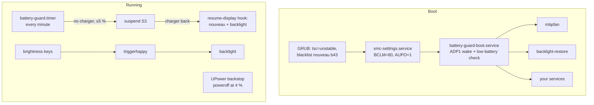

# MacBook Pro as a Home Server

Turning a **2010 MacBook Pro 13" (`MacBookPro7,1`)** into a headless **Ubuntu Server
24.04** box that runs 24/7: full CPU speed, sane fan control, a battery that works as
a UPS and brings the machine back by itself after a power outage, and a screen you
can still use.

Everything here was measured and tested on real hardware. The low-level parts (SMC
keys, GPU registers, wake sources) are specific to this model; the ideas apply to
other old Intel Macs.

## What you get

| Problem on a stock install | Fix | Doc |
|---|---|---|
| Boot takes 5-7 minutes | `tsc=unstable` | [01](docs/01-hardware-and-install.md) |
| CPU stuck at 1.59 GHz | Install a battery: without one the CPU is capped | [01](docs/01-hardware-and-install.md) |
| CPU hits 98 °C and throttles | `mbpfan` with an earlier curve: **+50 % throughput** | [02](docs/02-thermal-and-fan.md) |
| Battery always at 100 % | SMC charge limit `BCLM=80` | [03](docs/03-battery-and-smc.md) |
| Does not come back after an outage | Battery guard: suspend at 5 %, wake when the charger returns | [04](docs/04-power-management.md) |
| `poweroff` reboots (with `AUPO=1`) | `real-poweroff` | [03](docs/03-battery-and-smc.md) |
| No brightness control headless | Backlight through the GPU registers + brightness keys, down to fully off | [05](docs/05-display-and-backlight.md) |
| Black screen after resume | Load `nouveau` only after resume | [05](docs/05-display-and-backlight.md) |
| Reaching it from outside home | WireGuard + SSH `Match` | [06](docs/06-remote-access.md) |

## How it fits together



## Quick start

```bash
sudo apt install mbpfan triggerhappy upower python3
git clone https://github.com/luballe/Macbook-Pro-as-a-Home-Server.git
cd Macbook-Pro-as-a-Home-Server
sudo ./install.sh --dry-run    # shows what it would do
sudo ./install.sh
sudo server-status
```

Then apply the GRUB and UPower snippets in [config/](config/) by hand, and run the
[test plan](tests/test-plan.md).

`install.sh` refuses to run on another model unless `FORCE=1`: the GPU address,
the chip check and the SMC keys were only verified on `MacBookPro7,1`.

## Repository layout

| Path | Contents |
|---|---|
| [scripts/](scripts/) | `smc-key`, `smc-settings`, `battery-guard`, `real-poweroff`, `backlight`, `resume-display`, `server-status`, `bench` |
| [systemd/](systemd/) | Units and the triggerhappy override |
| [config/](config/) | `/etc/default` files, mbpfan, triggerhappy, logind, GRUB, UPower, WireGuard example |
| [docs/](docs/) | Hardware and install, thermal, battery and SMC, power management, display, remote access |
| [tests/](tests/test-plan.md) | Power and display test plan with results |
| [data/](data/) | Full battery discharge log, one sample per minute |

## Key numbers

| | |
|---|---|
| Boot (with `tsc=unstable`) | ~50 s |
| Idle draw as a server | ~15.7 W |
| Battery runtime from 100 % | 4 h 01 min |
| Draw while suspended | ~0.5 W (about 7 h on the 5 % reserve) |
| Dual-core throughput, no battery → battery + mbpfan | 978 → 1,677 bogo ops/s |

## Disclaimer

These scripts write to the SMC through `/dev/port` and to GPU registers through
PCI BAR0. They check the model and chip before writing, but a mistake at this level
can leave the machine misconfigured until an SMC reset. Read the code first. No
warranty (see [LICENSE](LICENSE)).

## Credits

Co-authored by **Luis Guillermo Ballesteros** ([@luballe](https://github.com/luballe))
and **Claude** (Anthropic), working together in Claude Code: diagnosis, scripts,
tests and documentation were done jointly on the real machine in November 2026.

Thanks to the authors of the Linux `applesmc` and `nouveau` drivers, whose code
documents the SMC protocol and the GeForce 320M backlight registers, and to
[mbpfan](https://github.com/linux-on-mac/mbpfan) and
[triggerhappy](https://github.com/wertarbyte/triggerhappy).
