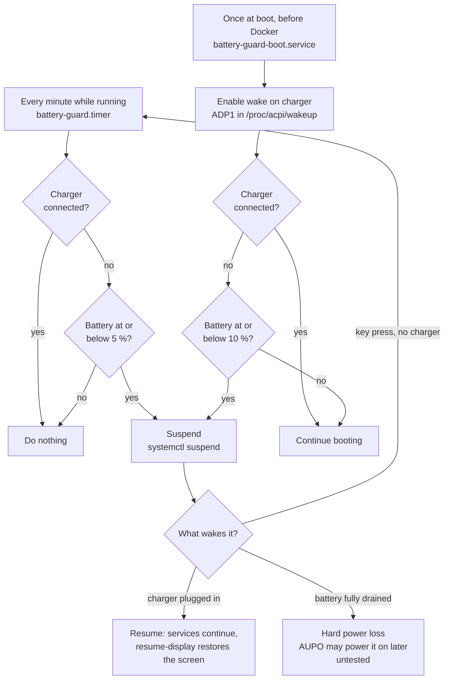
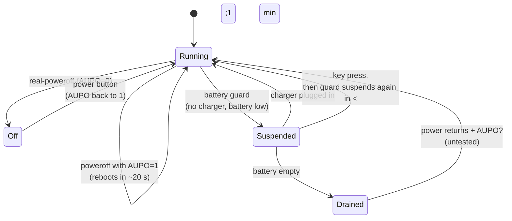

# 4. Power management: surviving power outages

## The problem

A laptop with a battery is a free UPS, but only if it comes back by itself:

1. The power goes out. The battery takes over (~3 h at `BCLM=80`).
2. The battery runs low and the system shuts down cleanly.
3. The power returns... and **the machine stays off** until someone presses the button.

## What was tried

| Approach | Result on MacBookPro7,1 |
|---|---|
| `AUPO=1` (SMC auto power-on) | Turns every poweroff into a reboot, but does **not** power on after a clean shutdown on a depleted battery |
| Shut down with an RTC alarm (`rtcwake -m no` + `poweroff`) to wake every 30 min | The alarm **only works with the charger connected**. On battery it never fires, and plugging in after the alarm time does not help either |
| **Suspend (S3) with ADP1 as a wake source** | **Works.** Plugging in the charger wakes the machine. Suspended it draws ~42 mA (~0.5 W), about 30 times less than running |

## The solution: battery guard

[`scripts/battery-guard`](../scripts/battery-guard) +
[`/etc/default/battery-guard`](../config/battery-guard):

The guard runs in two moments, each with its own threshold:

- **Every minute while running** (`SUSPEND_AT`, 5 %): the normal case during an outage.
- **Once at boot** (`BOOT_AT`, 10 %): a higher threshold, so the machine does not
  finish booting (and start Docker and other services) on an almost empty battery
  only to suspend a minute later.

Terms and acronyms are explained in the [glossary](glossary.md).

| Piece | Role |
|---|---|
| `battery-guard.timer` → `battery-guard check` | Every minute: no charger and battery ≤ `SUSPEND_AT` (5 %) → suspend. If something wakes it without the charger, it suspends again within a minute |
| `battery-guard-boot.service` → `battery-guard boot` | At boot, after `smc-settings` and before heavy services: enables ADP1 wake and suspends if booting without the charger at ≤ `BOOT_AT` (10 %) |
| `resume-display` (systemd sleep hook) | After resume, loads `nouveau` so the screen comes back ([05](05-display-and-backlight.md)) |
| UPower (backstop) | `PercentageCritical=5`, `PercentageAction=4`, `CriticalPowerAction=PowerOff` |

With 5 % in reserve it can wait about 7 hours suspended for the power to return.
5 % (not 1-2 %) because a worn battery can collapse quickly at the very end.

### Gotchas

- **`/proc/acpi/wakeup` toggles.** Writing `ADP1` flips its state, so the script
  only writes when it reads `disabled`. The setting is lost at every boot, so the
  boot service enables it again.
- **UPower does not run by default on a server.** It is D-Bus activated and only
  starts when something queries it, so its critical action never fires. Fix:
  `sudo systemctl add-wants multi-user.target upower.service`.
- **Use `systemctl suspend`, not `rtcwake -m mem`.** The latter writes
  `/sys/power/state` directly and skips the systemd sleep hooks (`resume-display`).
- When the guard suspends during boot, `systemd-networkd-wait-online` ends up
  `failed` (its 2-minute timeout expires while suspended). Harmless.
- Do not use `rtcwake` alarms to test wake-from-off on battery: they will not fire.

## Power states at a glance

## Still untested

What happens if the battery fully drains while suspended (an outage longer than
~3 h + ~7 h). That is a hard power loss, which is what `AUPO` is designed for, so
the machine may power on when the power returns. Testing it means draining the
battery again.
