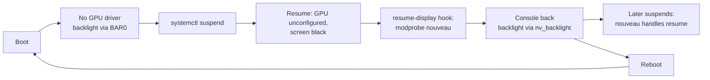

# 5. Display and backlight

With `nouveau` blacklisted (see [01](01-hardware-and-install.md)) there is no GPU
driver, so there is no `/sys/class/backlight`. `apple_bl` and
`acpi_backlight=vendor` do not create a backlight device on this model.

## Backlight without a driver

[`scripts/backlight`](../scripts/backlight) writes the panel PWM directly in BAR0 of
the GeForce 320M, as nouveau does (`nva3_set_intensity`):

| Register | Meaning |
|---|---|
| `0x61c080` | PWM divider (set up by the firmware at boot) |
| `0x61c084` | `0x80000000 \| (percent × divider / 100)` |

It first checks that the GPU has no driver bound and that the chip is MCP89
(`0x0af`). Levels: 0, 2, 4, 7, 10, 15, 20, 30, 40, 55, 70, 85, 100 %.
**0 % turns the backlight fully off.**

```bash
sudo backlight get | up | down | set 40 | restore
```

### Brightness keys

[`triggerhappy`](https://github.com/wertarbyte/triggerhappy) maps
`KEY_BRIGHTNESSUP`/`DOWN` to `backlight up`/`down`
([config/triggerhappy/backlight.conf](../config/triggerhappy/backlight.conf)).
It has to run as root to write the GPU register:
[systemd/triggerhappy.service.d/root.conf](../systemd/triggerhappy.service.d/root.conf).
`backlight-restore.service` applies the last level at boot.

## The screen after resuming from suspend

After S3 the GPU comes back **unconfigured**: the PWM divider reads 0 and the
screen stays black. Rewriting the backlight registers is not enough: the whole
display engine was set up by the firmware at power-on, and nothing redoes it.

**Fix:** load `nouveau` after resume. Loaded late, it initialises the GPU, brings
back the console (`nouveaudrmfb`) and exposes `nv_backlight`. It logs two harmless
`MMIO write ... FAULT` lines. The systemd sleep hook
[`scripts/resume-display`](../scripts/resume-display) does it, and then restores the
backlight level (at least 40 %, so you can see the machine is awake).



`backlight` picks the right path automatically: `nv_backlight` when `nouveau` is
bound, BAR0 otherwise. 0 % turns the panel fully off on both.

---

Terms and acronyms: [glossary](glossary.md).
